<h1 align="center">triumph-rebuild</h1>

<p align="center"><b>A from-scratch rebuild of the Xbox Series compatibility layer, in Rust,<br>
built around the right memory model from the first line, aiming at 30 frames a second.</b></p>

<p align="center">
  <a href="progress.md"></a>
  <a href="progress.md"></a>
  <a href="tasks.md"></a>
  <a href="plan.md"></a>
</p>

<p align="center">
  <a href="https://www.rust-lang.org"></a>
  <a href="https://learn.microsoft.com/windows/win32/direct3d12/directx-12-programming-guide"></a>
  <a href="HANDOFF.md"></a>
  <a href="runs/README.md"></a>
  <a href="LICENSE"></a>
</p>

<p align="center"><a href="progress.md"><b>Progress <code>[████░░░░░░░░░░░░░░░░]</code> 19 %</b></a><br>
<sub>work toward 30 fps, weighted by build step · no title frame measured yet</sub></p>

<table align="center">
  <tr>
    <td align="center"><a href="progress.md"><b>📈 Progress</b></a><br><sub>done, not done, one entry per upload</sub></td>
    <td align="center"><a href="plan.md"><b>🗺️ The plan</b></a><br><sub>six decisions, Builds 0-9</sub></td>
    <td align="center"><a href="tasks.md"><b>✅ Tasks</b></a><br><sub>every task and the number that closes it</sub></td>
    <td align="center"><a href="runs/README.md"><b>📊 Runs</b></a><br><sub>every measurement, raw output beside it</sub></td>
    <td align="center"><a href="HANDOFF.md"><b>🔍 Review brief</b></a><br><sub>for an independent reviewer</sub></td>
    <td align="center"><a href="thoughts.md"><b>💭 Thoughts</b></a><br><sub>the first reasoning</sub></td>
  </tr>
</table>

---

triumph-rebuild is a new compatibility layer that runs an Xbox Series title's own x86-64 code on Windows
and supplies everything underneath it: the console's system calls, its memory, and its GPU, translated to
Direct3D 12. It is built around one decision the layers it learned from make differently: **GPU-owned
memory lives in VRAM at the title's own addresses and is never copied back; only what the CPU really
changed goes up, in 64-byte chunks, off the submit thread.**

> [!IMPORTANT]
> This repository contains no game files, code or assets. You need your own copy of the title.
> Nothing here is affiliated with or endorsed by its developer or publisher.

## 📍 Where it stands

Measured on one machine: i7-10700KF, RTX 4070 Ti 12 GB, 64 GB RAM, PCIe 3.0, Windows 11.

| | now | target |
|:--|:--|:--|
| **Title frame** | not yet: the loader and runtime come in Build 3 | **30 fps · 33.3 ms** at ~4,500 draws, stated resolution and upscaler mode |
| **Memory** | ✅ tiles at console addresses, sharing by address, 10 GiB committed with 0 wrong ([Build 1](runs/build1-tiles.md)) | no copy-back, ever |
| **CPU → GPU upload** | ✅ 16-30 ms of worker time at the title's real shape, off the submit thread ([Build 0 a](runs/build0a-upload.md)) | inside a frame, overlapped |
| **List translation** | ✅ 0.43 µs a draw with the driver, 1.9 ms a frame ([Build 0 b](runs/build0b-lists.md)) | ≤ 7.4 µs a draw |
| **Descriptors** | ✅ 12,027 a frame from a dirty list: 2.0 ms | no scan |
| **Shaders** | 0 / 25,694; our own core, designed for GPU time (the fork translates all 25,694) | 25,694, wave32, 0 refused |
| **Upscaler** | not started; plan corrected (the title's upscale pass is found by bindings) | DLSS on NVIDIA, FSR on AMD |
| **Tests** | 27 green (`crates/uma` 22, `crates/xlist` 5) | |

Every result is reported as **fps · ms · draws · dropped** together, with resolution and upscaler mode.
A faster frame that draws less of the scene is not a win.

## 💡 Why a rebuild

**The layer we have runs the title at 7.6 fps (131.3 ms a frame), and the cost is in its shape, not its tuning.**

```mermaid
gantt
    title The frame being replaced: ~131 ms (fxceless-victory, same machine)
    dateFormat X
    axisFormat %L
    section Copies the mirror needs
    copies in (83-115 MB)       :0, 40
    copies back (60-65 MB)      :40, 91
    section Waiting
    title waits in present      :0, 68
    section The card
    layer's own hashing         :0, 26
    the title's own work        :26, 71
```



```
what was tried        19 measured A/B experiments against that structure: copy merging (4 ways),
                      double buffering, barrier de-duplication, rep movsb, upload heaps, wider
                      prepare, ordered copies ... every one neutral or worse
what that means       the copies exist because the layer gives the title plain CPU memory and keeps
                      a mirror; making copies cheaper cannot remove them
```

The layer has to give the GPU the title's memory **from the first allocation**. In the old tree that is a
retrofit into the allocator, the guard bookkeeping and the shadows all at once, and its own attempt failed
for exactly that reason: "0 regions placed", because the title's heap arrives page by page
([`ROADBLOCK.md`](https://github.com/jleybourne/Triumph/blob/main/ROADBLOCK.md) in the fork). Changing the memory model changes everything built on it, so we rebuild
around the right model instead of retrofitting the old one.

**Why not take the sibling layer (xcl) as it is:** its licence is GPL-2.0 and ours is GPL-3.0-only, and
copying its structure would also copy its ceilings. We read both layers to learn *how* each part works and
*what the title does*, then write our own.

| choice | why | evidence |
|:--|:--|:--|
| GPU-owned memory in VRAM at the title's addresses, never copied back | the copy-back is 48-54 ms of the old frame and exists only to fake shared memory | **measured here:** tiles at console addresses, sharing by address, 10 GiB with 0 wrong ([Build 1](runs/build1-tiles.md)) |
| CPU changes sent as 64-byte chunks, scattered by one compute dispatch, a frame ahead | the old layer copied 115 MB to deliver ~48 MB of real change; one copy per range costs more than the bytes | **measured here:** 16-30 ms of worker time at the title's real shape; one copy per range = 146 ms ([Build 0 a](runs/build0a-upload.md)) |
| list calls translated where the title records them, no cache | the old layer's 29 µs a draw looked like translation, but it was memory bookkeeping | **measured here:** 0.43 µs a draw, 1.9 ms a frame ([Build 0 b](runs/build0b-lists.md)) |
| descriptors as a dirty list | the old layer scanned 203,127 slots to update 12,027 | **measured here:** 12,027 writes = 2.0 ms |
| nothing compiles in a frame; wave32 everywhere | runtime compiles measured 4× slower per draw; 7 pipelines still refused for wanting 64-lane waves | old layer's runs; fork census |
| DLSS on NVIDIA, FSR on AMD | the title's own GPU work is 43-63 ms; 30 fps needs fewer pixels, not just less overhead | fork's per-list timestamps; how to lower the internal resolution is still open |

**What is still unproven, said plainly:** rebuilding versus keeping the old loader and shader translator
and replacing only the memory model has not been costed, and no title frame has run on this code yet.

## 🗺️ The plan

| | build | why | status |
|:--:|:--|:--|:--:|
| 0 | **Three answers before more code**: upload cost, translation cost, the title's GPU time | decide the design on numbers | ✅ a · ✅ b · ⏸️ c (needs a frame) |
| 1 | **Tiled VRAM at console addresses**, sharing by address, arena | no copy-back, ever | ✅ closed |
| 2 | **CPU-written memory on an async ring**; the GPU→CPU region | uploads off the submit thread; labels the title polls | 🔄 next |
| 3 | **PE loader + console runtime** | the title's own code runs | ⏳ |
| 4 | **Shaders**: 25,694 programs, our own core, wave32, offline | the full scene, no refusals, ~10-22 ms of GPU time back | 📐 decided |
| 5 | **D3D12.X device, lists, descriptors, present** | a frame, and the frame line | ⏳ |
| 6 | **List translation** on the title's threads | the CPU half of the frame | 🔄 core built |
| 7 | **Upscaler**: find the title's pass, lower the internal resolution, DLSS + FSR | fewer pixels | ⏳ |
| 8 | **Frame pacing** | frame time ≈ the card's own work: **30 fps on NVIDIA** | ⏳ |
| 9 | **AMD validation by testers** | 30 fps on AMD | ⏳ |

Full status with outcomes: **[tasks](tasks.md)** · **[progress](progress.md)**.

## 🔎 Recent findings

- **Tiles cost nothing measurable.** The upload benchmark onto tiled windows matches a plain buffer. The
  GPU swings between ~7-10 ms and ~19 ms with its clock state on both.
- **Only stencil formats can't be tiled** on this card. MSAA and plain depth tile fine.
- **List translation is not the CPU problem.** The D3D12 floor is ~0.4 µs a draw; the old layer's 29 µs
  was memory bookkeeping. The list cache is dropped from the plan.
- **The upload must be a scatter, not copies.** One `CopyBufferRegion` per changed range took 146 ms just to
  record at 440k ranges.
- **The title's FSR isn't an API call.** Method 0x218 creates pipelines; the upscale passes are ordinary
  dispatches found by their bindings (fork commit `ee0b94a3`, on its local `dlss-hook` branch, not pushed). Plan decision 5 is corrected.

## ▶️ Running it

Requirements: Windows 10/11 x64, a Direct3D 12 GPU with tiled resources tier 2 or higher, and Rust.

```powershell
cargo test --release                                  # 27 tests, no GPU or game data needed
cargo run --release --bin gputest                     # the GPU writes, the CPU reads, no copy
cargo run --release --bin gputest -- --bare           # control: never blame the machine
cargo run --release --bin gputest -- --tiled          # Build 1: tiles, console addresses, sharing
cargo run --release --bin gputest -- --arena          # what cannot be tiled on this card
cargo run --release --bin gputest -- --scale 10       # commit 10 GiB through the tiles
cargo run --release --bin uploadbench [-- --tiled]    # Build 0 (a): the upload benchmark
cargo run --release --bin listbench                   # Build 0 (b): per-draw translation
```

<details>
<summary><b>The tree</b></summary>

```
crates/uma        the address space: windows, 64 KiB pages, placement, sharing, card-page reuse;
                  tiles (reserved windows on 64 MiB heaps), the arena, the 64 B chunk diff and upload
crates/xlist      list calls as records; the lock-free translator into D3D12
apps/rebuild      the launcher, gputest, uploadbench, listbench
runs/             every measurement: a write-up and the raw output beside it
```
</details>

## 📏 The rules this project keeps

- **Measure, then promote.** A change lands only after a run that shows it. `fps · ms · draws · dropped`,
  always together.
- **One change per run.** Batches cannot be attributed, and they have already cost a night.
- **No claiming a mechanism works until a test or a run shows it.** Proofs are binaries, not paragraphs.
- **Read other layers for design, never for code.** The trees this learns from carry other licences. The one exception is decode code that carries no performance, vendored with credit.
- **Every upload updates [progress](progress.md)** with its own bar and notes.

## 📚 Documentation

| | page | what it holds |
|:--:|:--|:--|
| 📈 | [Progress](progress.md) | done / not done, % by build step, the shader bar, one entry per upload |
| 🗺️ | [Plan](plan.md) | the six decisions, the build order, what we refuse to build |
| ✅ | [Tasks](tasks.md) | every task with the number that closes it; known traps from the fork |
| 📊 | [Runs](runs/README.md) | Build 0 (a) upload, Build 0 (b) translation, Build 1 tiles |
| 🔍 | [Handoff](HANDOFF.md) · [Review prompt](REVIEW-PROMPT.md) | the brief for an independent review |
| 💭 | [Thoughts](thoughts.md) | the first reasoning, before the plan's corrections |
