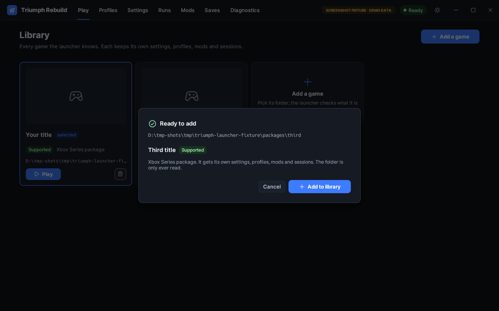
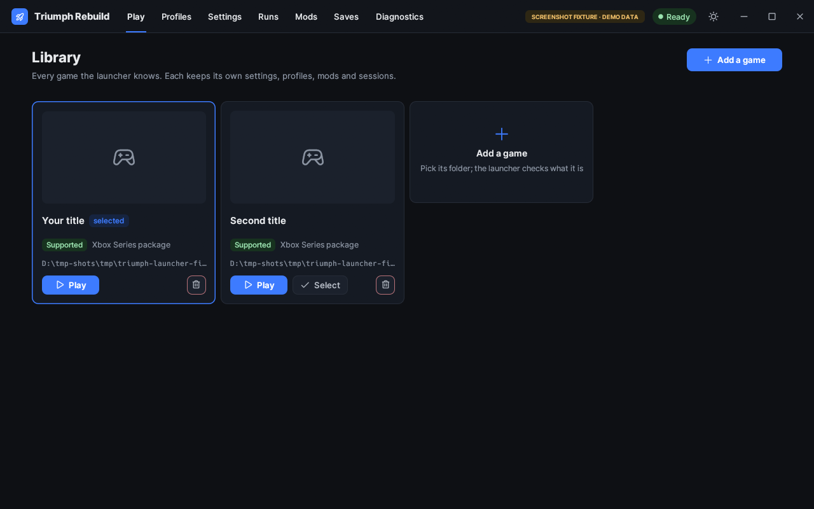
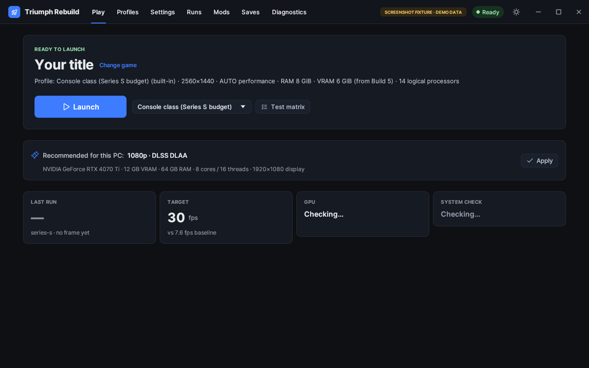
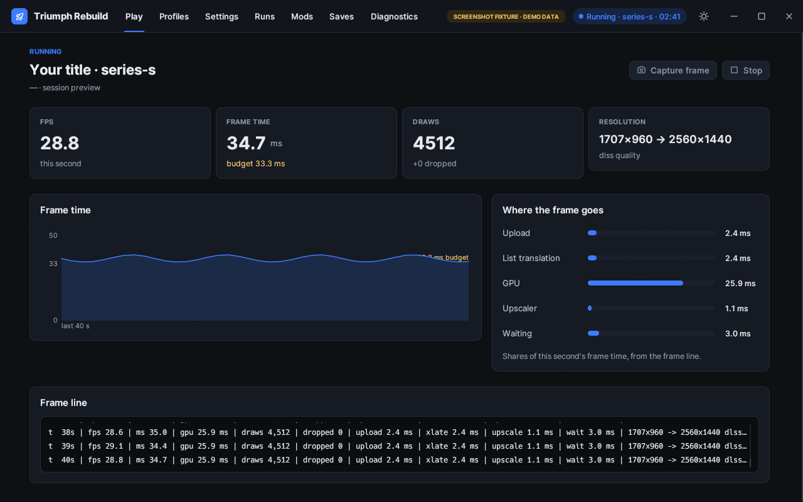
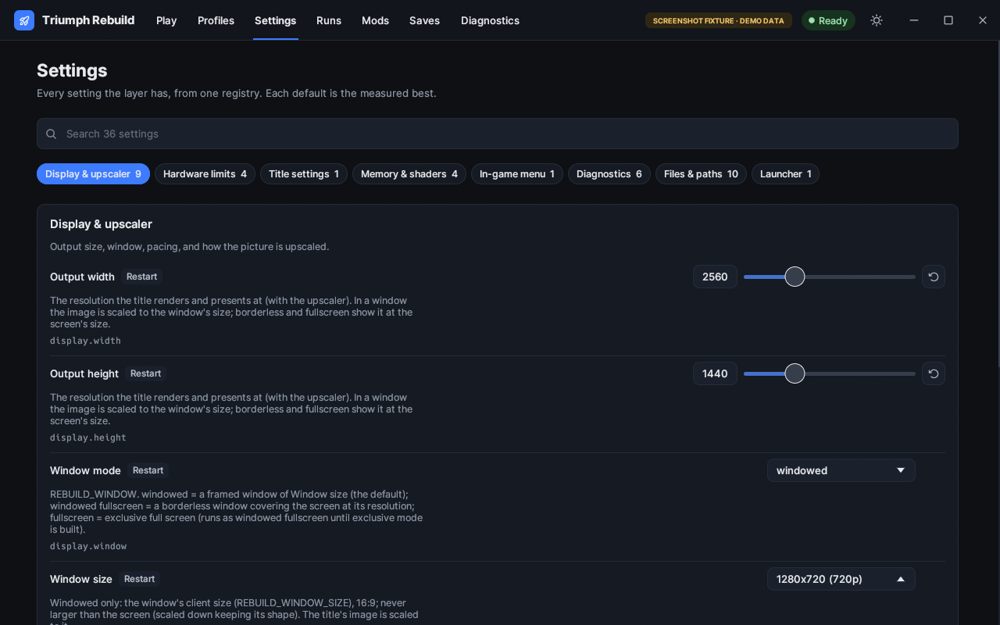
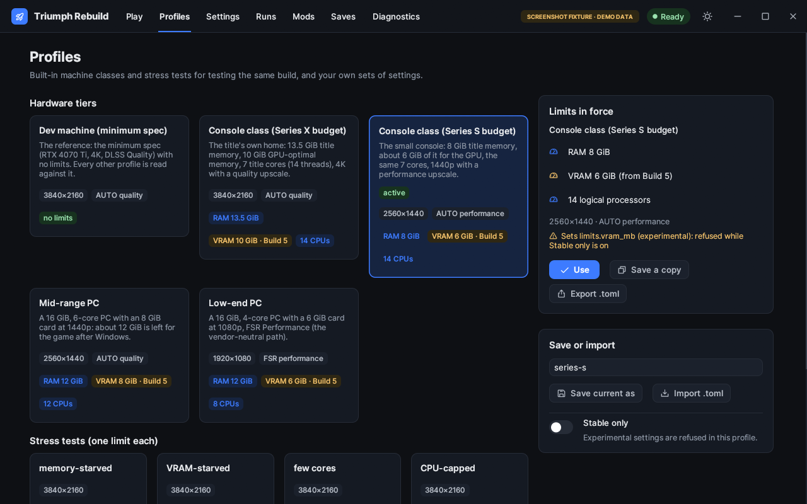
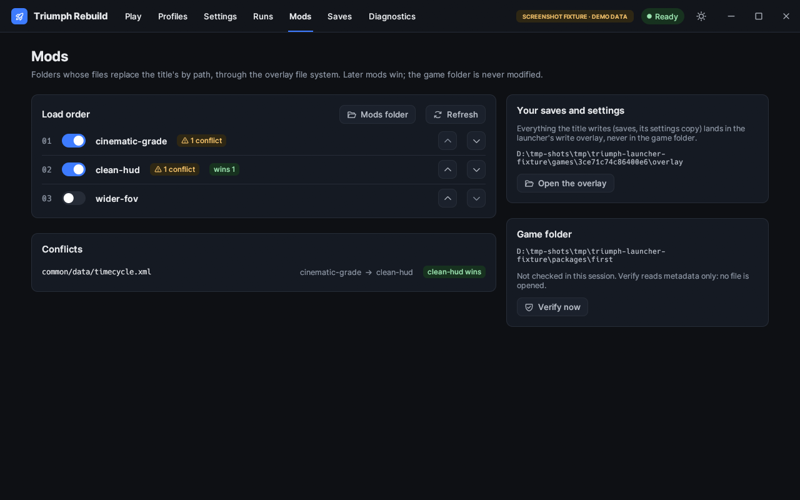
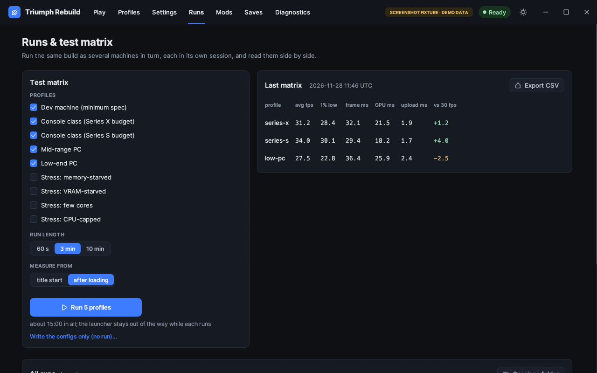
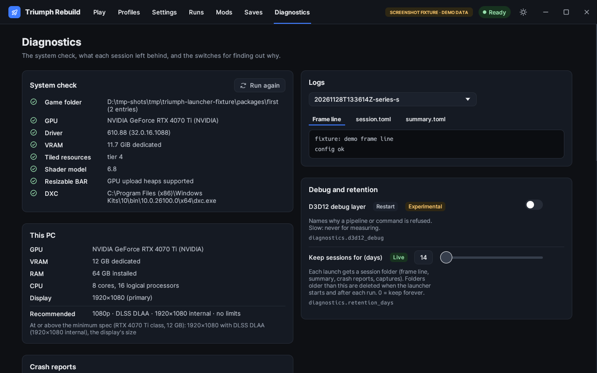

# Player's guide

How to install triumph-rebuild, add your game, and use the launcher. It is written for players. Developers
building from source want [building.md](building.md).

> [!IMPORTANT]
> **This is a preview.** The launcher, settings, profiles, saves, storage and mods all work. The game boots,
> plays its intro video and runs its first-run menus, but **gameplay is not reached yet**. Expect to test,
> not to play through. Progress is tracked in [progress](../progress.md).
>
> **First Play prepares shaders.** The game draws through a *shader library* translated from your own copy
> of the game, on your PC (nothing translated is ever shipped). The launcher builds it on the first Play
> ("Preparing shaders", with progress; you can play meanwhile, run it in the background, or continue later).
> Until it finishes, missing shaders are translated as the game asks for them, so the first minutes can stutter.

> [!NOTE]
> The download contains **no game files**. You need your own, legally obtained copy of the game. triumph-rebuild
> is not affiliated with or endorsed by the game's developer or publisher.

## Contents

1. [What you need](#1-what-you-need)
2. [Install and first launch](#2-install-and-first-launch)
3. [Add your game and press Play](#3-add-your-game-and-press-play)
4. [The recommended settings, profiles, window mode and size](#4-the-recommended-settings-profiles-window-mode-and-size)
5. [In game: the F10 menu and the performance monitor](#5-in-game-the-f10-menu-and-the-performance-monitor)
6. [Saves](#6-saves)
7. [Storage: where your files live](#7-storage-where-your-files-live)
8. [Mods](#8-mods)
9. [Runs and Diagnostics](#9-runs-and-diagnostics)
10. [Troubleshooting](#10-troubleshooting)
11. [Offline only, and what works today](#11-offline-only-and-what-works-today)

The screenshots come from the launcher's own screenshot mode. It fills the launcher with placeholder games and
demo numbers, and its top bar says **SCREENSHOT FIXTURE · DEMO DATA**. Your launcher shows your own game and
real numbers.

## 1. What you need

| | |
|:--|:--|
| **PC** | Windows 10 or 11, 64-bit |
| **Graphics card** | Direct3D 12 with *tiled resources tier 2* and *shader model 6.6*: most NVIDIA, AMD and Intel cards from the last several years, with an up-to-date driver. The launcher's system check tells you if yours qualifies |
| **Memory** | 16 GB of RAM or more is best. With less, the launcher shows a note |
| **The game** | your own copy, installed as a folder on this PC |
| **Disk** | the download is about 20 MB, 50 MB unzipped. Caches for your game grow to several GB, and you can put them on another drive |

You don't need to install anything else. The shader compiler the game needs (Microsoft's DXC) is in the zip.

## 2. Install and first launch

1. Download `triumph-rebuild-<version>-windows-x64.zip` from the project's GitHub **Releases** page.
2. Unzip it into a folder you own, such as `Documents\triumph-rebuild` or a folder on another drive.
   **Not** `Program Files`: the launcher keeps its files beside itself, and Windows doesn't let programs
   write there.
3. Open the folder and run **`rebuild-launcher.exe`**. Windows SmartScreen may warn about an unrecognised app,
   because the exe isn't signed. Choose *More info → Run anyway* if you trust the download.

The launcher opens on **Play**. On the very first start, with no game added yet, it opens the **Library**.

The launcher makes a `data` folder beside itself, and everything it and the game write goes there: settings,
saves, caches and logs. To move or remove triumph-rebuild, move or delete the one folder. See
[Storage](#7-storage-where-your-files-live).

## 3. Add your game and press Play

1. On the **Library** (from Play, **Change game**), choose **Add a game** and pick the folder the game was
   installed to: the one with its `MicrosoftGame.config` in it.
2. The launcher identifies the game and shows it as *Supported*, or *Not supported yet* for a title it can't
   run. **Add to library** adds it.
3. Each game keeps its own settings, profiles, mods, saves and sessions. A game you move to another drive keeps
   them too, because it is recognised by its package identity, not its folder.

The launcher **only reads** the game folder. It never writes there. On **Mods** you can check that the folder
is read-only, and it tells you how to make it so.

**Play:**

- **Launch** (or Ctrl+Enter) starts the game with the profile shown beside it.
- The strip **Recommended for this PC** says what the launcher picked for your hardware, and why (see the next
  section).
- The cards show the last run, the target (30 fps), your graphics card and the system check. If any check
  fails, **Open Diagnostics** shows the fix.

While the game runs, Play turns into the **Running** view, with live fps and frame time against the 33.3 ms
budget, a frame-time graph, draws, and the internal and output resolution. It has **Capture frame** (a
screenshot of the game's own image, saved in the session's folder) and **Stop**. By default the launcher
minimises itself while the game runs.

## 4. The recommended settings, profiles, window mode and size

**Recommended for this PC.** The first time you add a game, the launcher reads your graphics card, its video
memory, your RAM, CPU and screen, and sets the output resolution and the upscaler mode to suit them. It
tells you with a message ("Set up for this PC: …"). It does this **once per game** and never changes a
setting you have chosen yourself. Later you can press **Apply** on Play to return to the recommendation. It
changes only the resolution and upscaler, and keeps everything else.

**Settings** has every option, grouped (Display & upscaler, Hardware limits, Title settings, Memory &
shaders, In-game menu, Diagnostics, Files & paths, Launcher), with a search box. Each setting shows its help text, and a badge saying whether it applies **live** (in game, at once)
or on the next **restart** of the game. *Experimental* switches carry a warning. Changes wait in a save bar
at the bottom until you save them, and **reset to default** puts a setting back.

The display settings you are most likely to want:

| setting | choices |
|:--|:--|
| **Window mode** | *windowed* (the default), *windowed fullscreen* (a borderless window over the whole screen), *fullscreen* (behaves as windowed fullscreen for now) |
| **Window size** | for windowed: 120p, 240p, 480p, **720p (the default)**, 1080p, 1440p or 2160p, never larger than your screen |
| **Frame rate** | *title*: the game's own pacing, 30 fps (the default). *capped*: at most the **Frame cap** you set. *unlimited*: as fast as the PC can go |
| **Vsync** | wait for the display's refresh. Off by default |
| **Output width / height** | the resolution the game renders and presents at; the window scales it to its size |
| **Title settings** | edits to the game's own `settings.xml`, written into a copy each launch. The original file is never touched |

**Profiles** are named sets of settings. Save the current settings under a name, switch between them on
Play, or import and export them as `.toml` files. The **built-in test profiles** (console class, mid and low
PCs, stress tests) deliberately limit RAM, video memory or CPU, so this PC behaves like a weaker one. They are
for testing. Don't pick one to play: the recommendation is the right choice for playing.

## 5. In game: the F10 menu and the performance monitor

**The in-game menu.** Press **F10**, or **View + Menu** together on a controller. It opens over the game's
image, and while it is open the game gets no input. When it closes, input stays held back until you let go of
every key and button, so the closing press never reaches the game. It has three pages; change pages with **LB /
RB** or **Q / E**:

- **Settings:** every *live* setting (vsync, frame rate, frame cap, the performance monitor…). Left and right
  change a value, which applies at once and is saved when the menu closes.
- **Stats:** fps, frame time, GPU time and more, read-only.
- **Developer:** offline tools. Most aren't connected to the game yet and are shown dimmed.

**Esc** or **Start** closes the menu. The key can be changed to F11, F12, Insert or Home (Settings → In-game
menu key; it applies on the next launch).

**The performance monitor.** A small readout in the corner of the game shows fps, frame time and GPU time,
draws, the game's CPU, RAM and video memory use, and uploads. It is on by default. Turn it off with
**Resource monitor** in Settings or in the F10 menu.

## 6. Saves

The **Saves** page shows your game's offline saves, for every user on this PC.

- **The editor:** pick a save on the left to see what is inside. *Settings* saves (volume, field of view, HUD,
  controls…) can be edited field by field, and player saves by value. *Story-progress* saves are encrypted and
  signed by the game, so they are shown read-only.
- **Safe by design:** every write keeps a backup first and is all or nothing. Writes wait until the game is
  closed, and the editor never writes anything the game would reject. **Undo** restores the backup.
- **Import:** one button for anything that holds saves. Choose a file or a folder, or drop it on the window: an
  export from this launcher, a single save file, an edited save, or a saves folder from an older build. The
  launcher works out what it is and shows exactly what would be replaced. Nothing changes until you confirm,
  and the current saves are backed up first. Anything it can't recognise changes nothing.
- **Export:** one save, one save decoded as readable JSON, or **Export all** (every save with its manifest).

## 7. Storage: where your files live

**Diagnostics → Storage**, further down the Diagnostics page, shows where everything is, with an **Open
folder** button beside each:

- **The data folder.** Normally *Portable*: the `data` folder beside the launcher. If the launcher's folder
  can't be written to (Program Files, a read-only share), it uses *Per-user* folders instead: settings and
  saves in `%APPDATA%\triumph-rebuild`, caches and logs in `%LOCALAPPDATA%\triumph-rebuild`.
- **Per game:** saves (and how many users), the game's own storage, settings, the write overlay, mods,
  backups, the cache for each game build, and logs, each with its size.
- **Clear cache** deletes this game's caches: translated shaders, pipelines, prepared game images, decoded
  textures. They are rebuilt on the next launch, which makes that launch slower. **Clear old builds** removes
  only the caches of earlier versions of the game. Neither touches saves or settings.
- **Moving the caches.** Caches are the big part. To put them on another drive, set **Settings → Files &
  paths → Cache folder**. It applies the next time the launcher starts. Saves, settings and logs stay where
  they are.
- **Export / Import** of saves and settings: *Export saves…*, *Export settings…* or *Export both…* make one
  `.zip` with a manifest. *Import…* checks every file first. It refuses an export of another game, or a
  damaged one, and it won't run while the game is running. It backs up your current saves, shows what will
  change, and then **Back up and import** does it. An imported settings file keeps *this* PC's game folder.

## 8. Mods

A mod is a folder in the game's mods folder (**Mods → Mods folder → Open**). Its files replace the game's own
files with the same path. The game folder is never changed: mods are layered over it while the game runs.

- Turn each mod on or off, and move it up or down to set the **load order**: later mods win.
- **Conflicts** lists files that two enabled mods both replace, and which mod wins.
- Only file-replacement mods are supported. Script or code mods are not.
- The same page checks that your game folder is read-only (**Verify now**) and tells you how to make it so.

## 9. Runs and Diagnostics

**Runs** keeps every play session: when it ran, the profile, and the numbers (average fps, 1 % low, frame,
GPU and upload time). The **test matrix** runs the same build under several profiles in turn, so you can
compare them side by side and export a CSV. Testers find this useful for reports.

**Diagnostics:**

- **System check:** your graphics card, driver, video memory, tiled resources, shader model, resizable BAR,
  DXC and the game folder. Each failure comes with a one-line fix. **Run again** after fixing.
- **This PC:** the detected hardware and the recommendation, with its reasons and notes.
- **Sessions:** each session's frame line, its `session.toml` and `summary.toml`, any **crash reports**
  (**Copy for a bug report**) and frame captures.
- Session folders are deleted after 14 days (**Keep sessions for (days)** under *Debug and retention*; 0
  keeps them forever).
- The launcher makes no network connection of any kind, and has no telemetry.

## 10. Troubleshooting

| what you see | what to do |
|:--|:--|
| SmartScreen: "Windows protected your PC" | the exe is unsigned: *More info → Run anyway*, if you trust where you downloaded it |
| "rebuild.exe not found beside the launcher" | keep every file of the zip together in one folder. Don't move `rebuild-launcher.exe` out on its own |
| The system check fails *Tiled resources* or *Shader model* | update your graphics driver. If it still fails, the card is too old for this layer |
| The system check fails *DXC* | `dxc.exe`, `dxcompiler.dll` and `dxil.dll` must be beside the launcher. Unzip again |
| The game isn't *Supported* | pick the folder that holds the game's `MicrosoftGame.config`. Only the supported title runs today |
| Settings and saves aren't in `data\` | the launcher's folder is read-only, so it uses `%APPDATA%` and `%LOCALAPPDATA%` (Diagnostics → Storage says so). Move the folder somewhere you own |
| Import is refused | close the game first. An export of another game, or a damaged file, is always refused, and nothing changes |
| The first launch, or the first after Clear cache, is slow | caches are being rebuilt. Later launches are faster |
| The first Play is slow or stutters | the shader library is still being prepared (see the note at the top); later launches use it |
| The game stops after its menus, or while the world loads | expected in this preview: gameplay isn't reached yet. A crash report (Diagnostics) still helps |
| A crash | Diagnostics → Crash reports → **Copy for a bug report**, and open an issue on GitHub with it and your system check |

## 11. Offline only, and what works today

- **Offline only.** triumph-rebuild plays offline as a local offline user. There is no online play, and none
  is planned. The launcher never connects to the network.
- **What works:** the launcher (library, recommended settings, settings, profiles, mods, saves, storage,
  runs and diagnostics). Once the shader library is prepared, the game boots, plays its intro video, runs its
  first-run menus readably at its own 30 fps, and saves.
- **What doesn't yet:** gameplay
  (the world starts loading and goes no further yet), and upscaling (DLSS and
  FSR run on their own but aren't connected to the game; the DLLs aren't bundled and are optional). Exclusive
  fullscreen behaves as windowed fullscreen.

What is being built, and what is next: [features](../FEATURES.md) · [progress](../progress.md).
